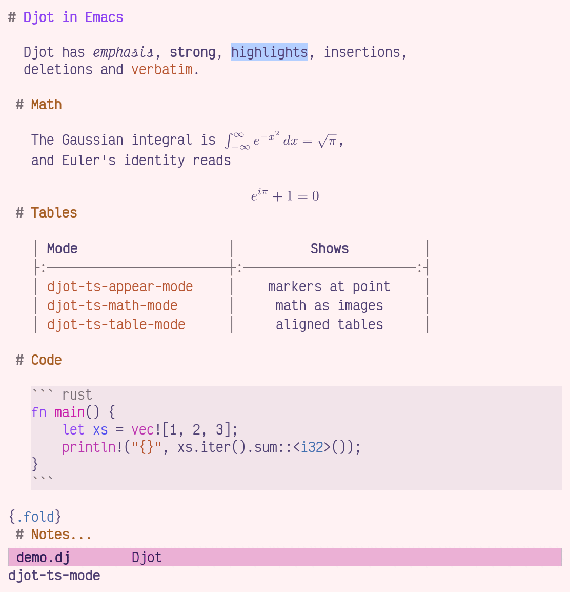

# djot-ts-mode

Emacs major mode for [Djot](https://djot.net), using tree-sitter.



## Features

- `djot-ts-mode`: highlighting, imenu, and folding of sections and
  blocks. Code blocks are highlighted with their language's
  tree-sitter mode.
- `djot-ts-appear-mode`: hides inline markup markers except at point.
- `djot-ts-indent-mode`: indents text by section depth, like
  `org-indent-mode`.
- `djot-ts-math-mode`: shows math as images, using `org-latex-preview`.
- `djot-ts-table-mode`: aligns pipe tables.

## Installation

Install the grammar from [this fork](https://github.com/lua-vr/tree-sitter-djot)
of tree-sitter-djot:

```elisp
(add-to-list 'treesit-language-source-alist
             '(djot "https://github.com/lua-vr/tree-sitter-djot"))
(treesit-install-language-grammar 'djot)
```

Then add this directory to `load-path` and enable the minor modes you
want:

```elisp
(use-package djot-ts-mode
  :load-path "path/to/djot-ts-mode"
  :mode "\\.dj\\'"
  :hook ((djot-ts-mode . djot-ts-appear-mode)
         (djot-ts-mode . djot-ts-indent-mode)
         (djot-ts-mode . djot-ts-math-mode)
         (djot-ts-mode . djot-ts-table-mode)))
```
